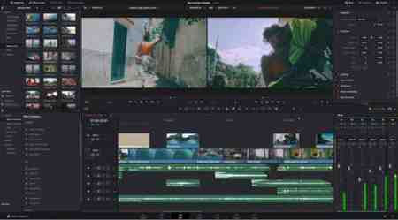

# ActionCam MCP Studio

An AI-assisted, local-first Desktop UI and Model Context Protocol (MCP) video production workflow connecting the **DJI Osmo Action 4** with **DaVinci Resolve Studio 21**.



New to the DJI Osmo Action 4 or DaVinci Resolve? Start with the [Getting Started guide](docs/getting-started/README.md).

- [Memory card and recording workflow](docs/getting-started/01-memory-card-and-recording.md)
- [Beginner camera configuration](docs/getting-started/02-camera-configuration.md)
- [Handheld videography and first exercise](docs/getting-started/03-handheld-shooting-exercise.md)
- [DaVinci Resolve setup and first project](docs/getting-started/04-davinci-resolve-first-project.md)
- [Troubleshooting and next steps](docs/getting-started/05-troubleshooting-and-next-steps.md)

## Phase 1 — Camera mastery

- [Phase 1.2 — Exposure](docs/getting-started/phase-1-2-exposure.md)
- [Phase 1.3 — Frame rates and slow motion](docs/getting-started/phase-1-3-frame-rates-slow-motion.md)
- [Phase 1.4 — Colour profiles, CST and Rec.709](docs/getting-started/phase-1-4-colour-profiles-cst-rec709.md)
- [Phase 1.5 — Media workflow and Resolve performance](docs/getting-started/phase-1-5-media-workflow-performance.md)

The learning guides use official product references and clearly distinguish those references from actual camera-menu screenshots.

The long-term goal is a local-first workflow for recording, organizing, editing, colour grading, validating exports, and using AI/MCP tools to assist video production.

See the [GitHub Wiki](https://github.com/luckyhegde6/actionCamMcp/wiki) for the companion learning guides.

## Contributor and AI-agent workflows

- [Repository skills index](skills/README.md)
- [ChatGPT Codex + GitHub workflow](skills/chatgpt-codex-github-workflow/SKILL.md)
- [GitHub Wiki Git publishing](skills/github-wiki-git-publishing/SKILL.md)
- [Wiki and Codex publishing architecture](docs/GITHUB_WIKI_AND_CODEX_WORKFLOW.md)
---

## 🌟 Key Features

1. **🖥️ Native Desktop UI Workflow**:
   - Single-click launch in standalone desktop window (`python run.py desktop`).
   - Real-time DaVinci Resolve Studio connection indicator and project manager.
   - 6-step guided production pipeline from raw memory card ingest to final render.

2. **📁 Smart Media Ingest & Folder Organizer**:
   - Scans camera SD cards (DCIM) and local raw directories.
   - Pure-Python MP4 metadata parser detecting 120fps / 60fps high-speed action clips vs 25fps realtime footage.
   - Automatically builds a standardized folder hierarchy and DaVinci Resolve Media Pool bins (`01 Raw Footage`, `02 Reference Edits`, `03 Audio & SFX`, `04 Timelines`, `05 Exports`).

3. **🎨 Camera Presets & LUT Hub**:
   - Specialized presets for **DJI Osmo Action 4 10-Bit D-Log M**.
   - Built-in `.cube` color transformations (D-Log M &rarr; Rec.709, Cinematic Teal & Orange, Vibrant Mountain Action).
   - Direct node-level LUT application on timeline clips.

4. **🎬 Reference Video Decoder (Reverse-Engineering Edits)**:
   - Uses DaVinci Resolve Studio's **Neural Engine `DetectSceneCuts()`** to analyze and decode reference videos.
   - Extracts exact shot durations, rhythm, fast-montage vs establishing pacing, and cut transitions.
   - Interactive timeline visualizer with cut blocks and pacing arcs.

5. **⚡ Smart Cut Matcher & Assembly**:
   - Automatically maps raw clips from chosen directories into the reference video's rhythm.
   - Retimes 120fps action clips into smooth slow-motion (0.208&times; speed) with optical flow interpolation.
   - Trims in/out points to skip camera shake and align with energy peaks.
   - Directly constructs the live timeline in DaVinci Resolve Studio or exports standard **FCPXML 1.9** for instant project import.

6. **🎵 Sound Design & Fairlight Layout**:
   - Aligns Background Music (BGM) to Timeline Track A1.
   - Automatically detects cut transitions and places impact SFX (sub-bass hits) and whoosh risers (Track A2 & A3).
   - Fairlight audio ducking parameters.

7. **🚀 Deliver & Export Presets**:
   - One-click render queue dispatch for **YouTube 4K UHD** (3840&times;2160 H.265 45 Mbps), **Instagram Reels / TikTok / Shorts (9:16)** (1080&times;1920), **Master Archive** (DNxHR HQX 10-bit), and **Web 1080p Fast**.

8. **🤖 Model Context Protocol (MCP) Server**:
   - Standard JSON-RPC 2.0 stdio server (`python run.py mcp`).
   - Exposes DaVinci Resolve automation tools to Claude Desktop, Antigravity, and Cursor.

---

## 🚀 Quick Start

### 1. Configure DaVinci Resolve Studio
In DaVinci Resolve Studio:
1. Open **Preferences** (`Ctrl + ,`).
2. Go to **System > General**.
3. Set **External scripting using** to **Local**.
4. Click **Save**.

### 2. Launch the Desktop UI
```powershell
# From the project root
python run.py desktop
```
This launches the local engine server and opens the dark-mode Desktop UI in a clean application window!

Alternatively, if you prefer using a browser:
```powershell
python run.py server
# Then navigate to http://127.0.0.1:8765/
```

### 3. Check DaVinci Resolve Connection
```powershell
python run.py status
```

### 4. Using the Desktop UI (Step-by-Step)
1. **Launch**: Run `python run.py desktop` (or `python run.py server` and open `http://127.0.0.1:8765/`).
2. **Verify Resolve Status**: Check the top-right status pill confirms DaVinci Resolve Studio is connected and your active project (e.g. `test1`) is loaded.
3. **Select Source & Organize**: Choose your DJI Osmo Action 4 source directory and target project folder to scan 100fps/120fps slow-mo vs 24–50fps realtime clips and create Media Pool bins.
4. **Pick Camera Preset & LUT**: Select **DJI Action 4 D-Log M** and apply `DJI/DJI OSMO Action 4 D-Log M to Rec.709 V1.cube` (plus optional CDL grading).
5. **Decode Reference & Assemble Cuts**: Optionally load a reference video to run Neural Engine `DetectSceneCuts()`, or run curated timeline scripts (`scripts/build_illumen_dev_video.py`, `scripts/build_journey_and_cat_timelines.py`).
6. **Audio Mixin (``)**: The default audio mixin source is `` (override with `ACTIONCAM_SOUNDS_DIR`). `AudioEngine.scan_sounds_library()` categorizes ambience, whooshes, impacts, chimes, and BGM for Fairlight tracks `A1`–`A3`.
7. **Classify & Export**: `ExportManager` automatically routes renders by platform into `exports/YouTube/`, `exports/Reels_Shorts/`, `exports/Master/`, or `exports/Web_Preview/`.

### 5. DaVinci Resolve Workflow Integration Plugin
To install the native Workflow Integration Plugin inside DaVinci Resolve Studio:
```powershell
# Run from an elevated (Administrator) PowerShell
python install_plugin.py
```
Then open **Workspace > Workflow Integration > ActionCam MCP Studio** inside DaVinci Resolve.

---

## 🤖 Model Context Protocol (MCP) Configuration

To connect this workflow to Claude Desktop or Antigravity, add the following to your MCP configuration file (`claude_desktop_config.json`):

```json
{
  "mcpServers": {
    "actioncam-mcp": {
      "command": "python",
      "args": ["<path-to-actionCamMcp>/run.py", "mcp"],
      "env": {
        "RESOLVE_SCRIPT_API": "C:\\ProgramData\\Blackmagic Design\\DaVinci Resolve\\Support\\Developer\\Scripting",
        "RESOLVE_SCRIPT_LIB": "C:\\Program Files\\Blackmagic Design\\DaVinci Resolve\\fusionscript.dll",
        "PYTHONPATH": "C:\\ProgramData\\Blackmagic Design\\DaVinci Resolve\\Support\\Developer\\Scripting\\Modules"
      }
    }
  }
}
```

### Available MCP Tools:
- `actioncam_check_status`: Check Resolve connection and active project.
- `actioncam_scan_and_organize`: Scan camera card and organize project folders.
- `actioncam_decode_reference_video`: Run Neural Engine scene cut detection and pacing analysis.
- `actioncam_assemble_timeline`: Match cuts, retime slow-mo, apply LUTs, and assemble the timeline.
- `actioncam_queue_export`: Dispatch Deliver page render queue jobs.
- `actioncam_run_full_workflow`: Run the full end-to-end pipeline in a single command.

---

## 📁 Repository Structure

```text
actionCamMcp/
├── actioncam_mcp/
│   ├── config.py                  # Resolve paths, directory templates, export profiles
│   ├── core/
│   │   ├── resolve_client.py      # DaVinci Resolve Scripting API client
│   │   ├── media_organizer.py     # ISO MP4 metadata scanner & bin organizer
│   │   ├── reference_decoder.py   # Neural Engine scene cut & pacing decoder
│   │   ├── cut_matcher.py         # Clip-to-cut matcher & slow-mo retimer
│   │   ├── audio_engine.py        # BGM alignment & cut-point SFX placer
│   │   ├── export_manager.py      # Deliver page render queue manager
│   │   └── fcpxml_generator.py    # FCPXML 1.9 generator for DaVinci Resolve
│   ├── server/
│   │   ├── mcp_server.py          # Model Context Protocol (JSON-RPC stdio)
│   │   └── http_api.py            # Desktop UI REST & Web server
│   ├── desktop_ui/
│   │   ├── index.html             # Desktop UI dashboard
│   │   ├── app.js                 # Frontend application logic & live polling
│   │   ├── styles.css             # DaVinci Resolve-inspired dark UI theme
│   │   └── launch_desktop.py      # Desktop app window launcher
│   └── presets/                   # Workflow and camera presets (D-Log M, Reels)
├── docs/
│   ├── WORKFLOW_GUIDE.md          # Comprehensive workflow documentation
│   └── getting-started/           # Beginner guides for Action 4 & Resolve
├── tests/
│   └── test_workflow.py           # Integration test suite
└── run.py                         # Unified CLI entrypoint
```

---

## 🧪 Testing

Run the automated integration test suite:
```powershell
python tests/test_workflow.py
```

---

## 📄 License

GPLv3 &copy; 2026. See [LICENSE](LICENSE) for details.
