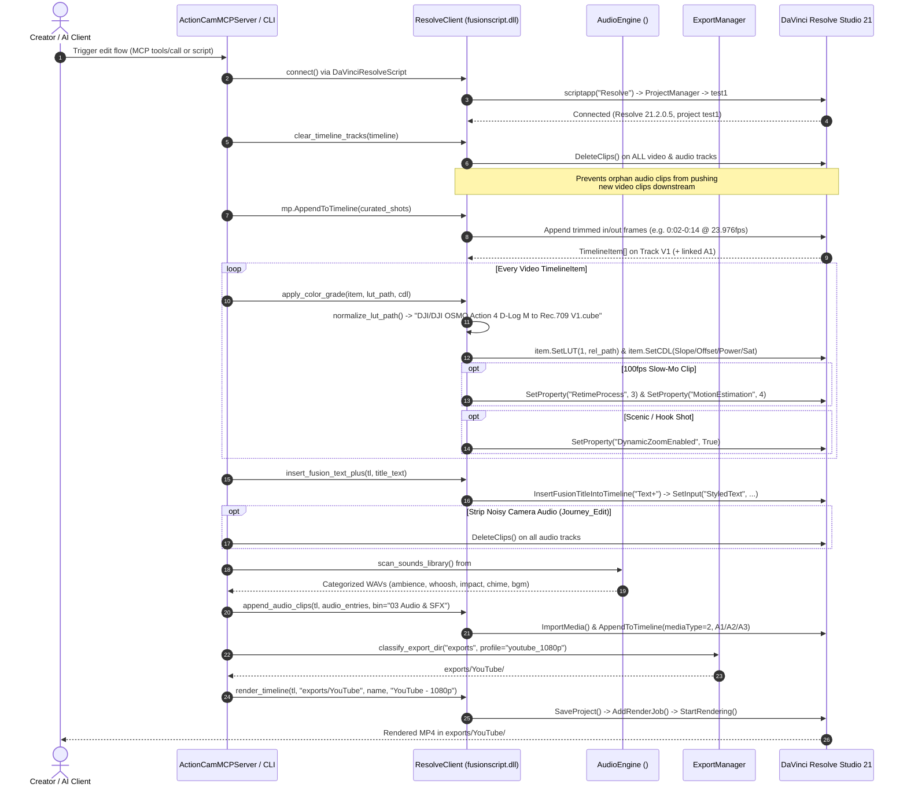
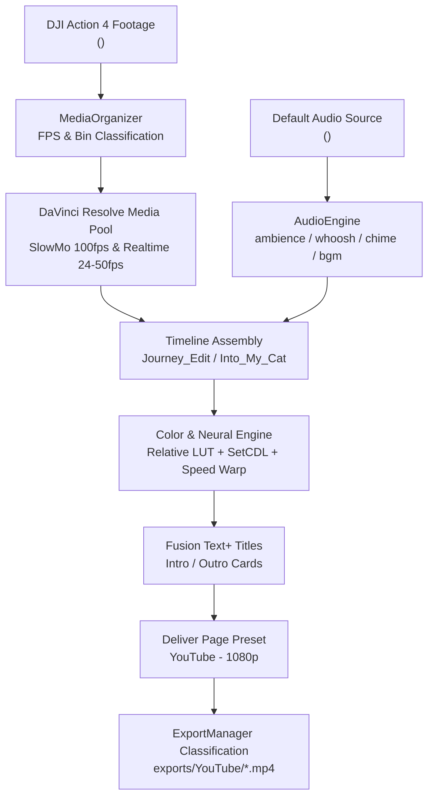

# ActionCam MCP & DaVinci Resolve Studio 21 — Edits Flow Explainer

This document explains how **ActionCam MCP Studio** orchestrates **DJI Osmo Action 4** footage, **``**, and **DaVinci Resolve Studio 21** via the Model Context Protocol (MCP), Python Scripting API (`fusionscript.dll`), and automated Deliver classification.

---

## 1. End-to-End Sequence Diagram (MCP + DaVinci Resolve 21)

---

## 2. System & Data-Flow Architecture

---

## 3. How Each Stage Works Under the Hood

### Stage A — MCP & Scripting Connection
- `ActionCamMCPServer` (`actioncam_mcp/server/mcp_server.py`) exposes JSON-RPC 2.0 tools (`actioncam_check_status`, `actioncam_scan_and_organize`, `actioncam_decode_reference_video`, `actioncam_assemble_timeline`, `actioncam_queue_export`, `actioncam_run_full_workflow`) over `stdio`.
- `ResolveClient` (`actioncam_mcp/core/resolve_client.py`) prepends `C:\ProgramData\Blackmagic Design\DaVinci Resolve\Support\Developer\Scripting\Modules` to `sys.path` (preventing sandbox `PYTHONPATH` shadowing) and connects via `fusionscript.dll` (`dvr.scriptapp("Resolve")`).

### Stage B — Timeline Rebuilding & Frame Math
- **Clearing All Tracks**: `ResolveClient.clear_timeline_tracks()` deletes clips on **all** `video` and `audio` tracks before `AppendToTimeline()`. Otherwise, leftover audio clips push new video clips downstream and create leading black screen + noise.
- **Mixed Frame-Rate Trimming**: Source `in`/`out` frames use the **source clip's FPS** (`23.976fps` for `0038_D` where `0:02`–`0:14` = frames `48`→`336`, vs `100.0fps` for `0039_D` and `0015`–`0023`).

### Stage C — Color Grading, LUTs & Speed Warp (Resolve 21.2 Rules)
- **Relative LUT Paths**: `item.SetLUT(1, ...)` rejects absolute filesystem paths. `ResolveClient.normalize_lut_path()` strips the prefix before `/Support/LUT/` so `DJI/DJI OSMO Action 4 D-Log M to Rec.709 V1.cube` applies reliably.
- **CDL Fine-Tuning**: `ResolveClient.apply_color_grade()` applies `item.SetCDL({"NodeIndex": "1", "Slope": ..., "Offset": ..., "Power": ..., "Saturation": ...})` to lift brightness or warm sunrise tones while preserving the original D-Log M look.
- **Speed Warp**: Resolve 21.2 requires integer enums (`RetimeProcess=3` for Optical Flow, `MotionEstimation=4` for Speed Warp) rather than display strings.

### Stage D — Audio Mixing (``) & Export Classification
- `AudioEngine` defaults to `DEFAULT_SOUNDS_DIR` (``, configurable via `ACTIONCAM_SOUNDS_DIR`).
- For serene/sunrise edits (`Journey_Edit`), original camera audio is stripped before layering ambience (`A1`) and cut-transition whooshes (`A2`).
- `ExportManager.classify_export_dir()` inspects the export profile/preset/filename and routes renders into `exports/YouTube/`, `exports/Reels_Shorts/`, `exports/Master/`, or `exports/Web_Preview/`.
