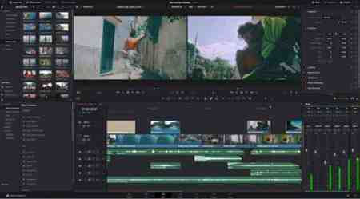
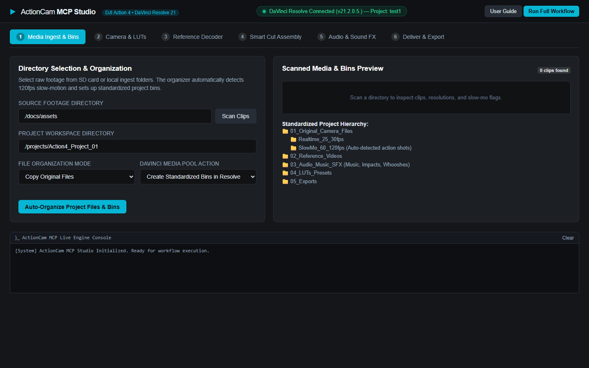
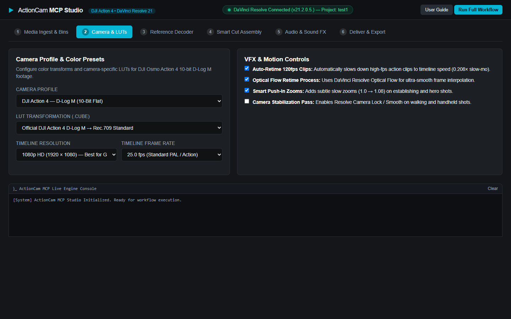
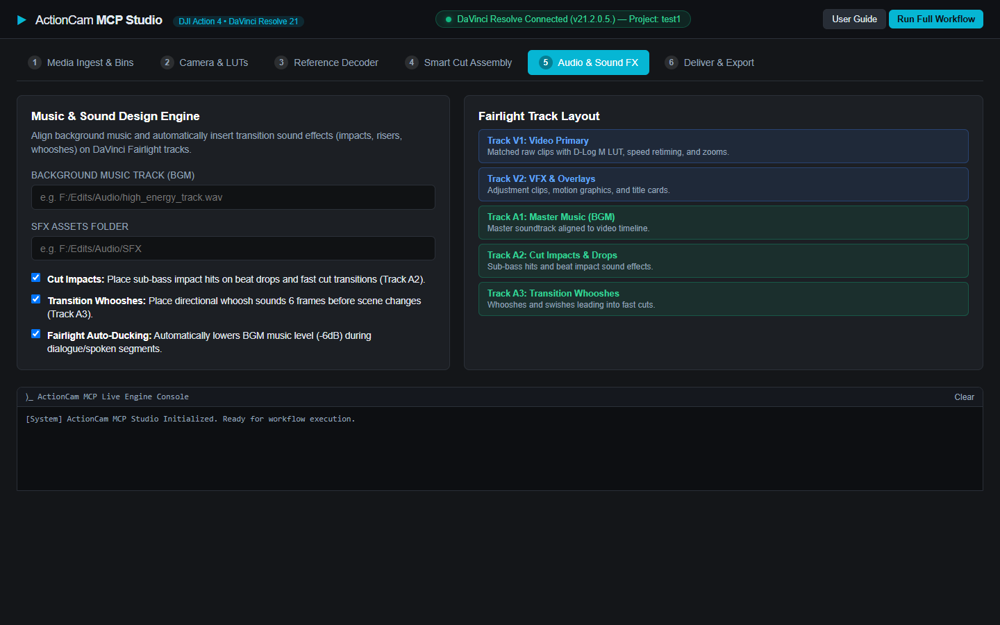
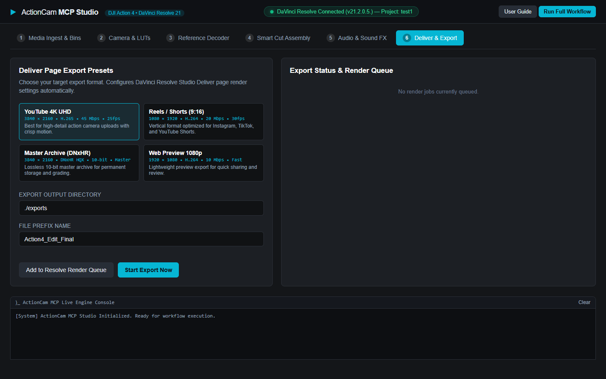
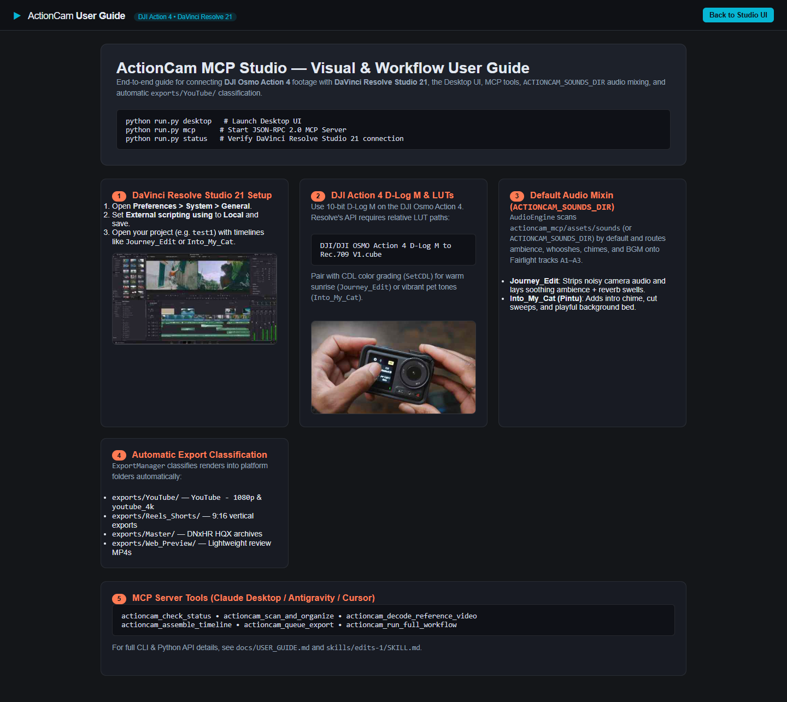

# ActionCam MCP Studio — Visual User Guide

A complete visual & operational guide for using **ActionCam MCP Studio** with **DJI Osmo Action 4** footage and **DaVinci Resolve Studio 21**.

---

## 1. DaVinci Resolve Studio 21 Preparation

1. Open **DaVinci Resolve Studio 21** and go to **Preferences > System > General**.
2. Set **External scripting using** to **Local**, save, and restart Resolve if changed.
3. Open your target project (e.g. `test1`).



---

## 2. Launching the Desktop UI & Checking Connection

Launch the Desktop UI from the project root:
```powershell
python run.py desktop
# Or start the web server directly:
python run.py server
```

In the top header, verify the **Resolve Connection** pill shows **Connected** (`21.2.0.5`), and use the **User Guide** button to open the built-in `guide.html` reference at any time.



---

## 3. Camera Presets, D-Log M LUTs & Color Grading

Record in **10-bit D-Log M** on the DJI Osmo Action 4. In **Camera & LUTs**, select the `dji_action4_dlog_m` preset:
- Base technical LUT (relative to Resolve's `Support/LUT/` directory):
  `DJI/DJI OSMO Action 4 D-Log M to Rec.709 V1.cube`
- Optional CDL grading (`SetCDL`) for warm sunrise (`Journey_Edit`) or vibrant pet tones (`Into_My_Cat`).



---

## 4. Audio Mixin Source (``) & Sound FX

`AudioEngine` defaults to `` (override with `ACTIONCAM_SOUNDS_DIR`). It scans and categorizes `.wav`/`.mp3` files into ambience, whooshes, impacts, chimes, and BGM onto Fairlight tracks `A1`–`A3`:
- **`Journey_Edit`**: Strips noisy camera audio (`clear_audio_only`) and mixes nature ambience + reverb swells.
- **`Into_My_Cat` (Pintu)**: Adds intro chime, cut sweeps, and a playful background bed.



---

## 5. Deliver & Automatic Export Classification (`exports/YouTube/`)

`ExportManager` automatically classifies exports into platform subfolders under `exports/`:
- `exports/YouTube/` — `YouTube - 1080p` & `youtube_4k` (with `.youtube.json` SEO sidecar & optional OAuth2 upload via `YouTubePublisher` / `YOUTUBE_OAUTH_TOKEN` and reference search inspired by `ia-programming/youtube-mcp`)
- `exports/Reels_Shorts/` — `reels_shorts_9_16`
- `exports/Master/` — `master_dnxhr`
- `exports/Web_Preview/` — `web_1080p_fast`



---

## 6. Built-in Desktop User Guide Page (`guide.html`)

Click **User Guide** in the Desktop UI header (or navigate to `http://127.0.0.1:8765/guide.html`) for the interactive in-app guide:



---

## 7. Running Tests & Playwright UI Verification

```powershell
# Core workflow integration test
python tests/test_workflow.py

# Unit, MCP, and HTTP API test suite
python tests/test_suite.py

# Playwright headless UI & screenshot verification
node tests/capture_ui_screenshots.mjs
```

---

## 8. Bugs Found & Resolved During Verification

| # | Bug Found | Root Cause | Resolution |
| :--- | :--- | :--- | :--- |
| 1 | `NameError: name 'Any' is not defined` in `http_api.py` | Missing `from typing import Any, Optional` | Added `Any, Optional` imports to `actioncam_mcp/server/http_api.py`. |
| 2 | `/docs/assets/*` images 404 inside `guide.html` | `SimpleHTTPRequestHandler` only served `desktop_ui/` | Added `/docs/assets/` static route in `DesktopAPIHandler.do_GET()`. |
| 3 | `test_mcp_server_tools_and_status` assertion mismatch | `actioncam_check_status` returns `"connected"`, not `"resolve_connected"` | Updated `tests/test_suite.py` to assert `"connected"`. |
| 4 | Leading 2m29s noise/black screen on rebuilt timelines | Clearing only `video` track 1 left orphan audio clips pushing `AppendToTimeline` downstream | Added `ResolveClient.clear_timeline_tracks()` to clear all video & audio tracks. |
| 5 | `SetLUT()` and Speed Warp failing in Resolve 21.2 | `SetLUT` requires relative paths; Speed Warp requires integer enums (`3`, `4`) | Added `ResolveClient.normalize_lut_path()` and updated `apply_studio_speed_warp()`. |
