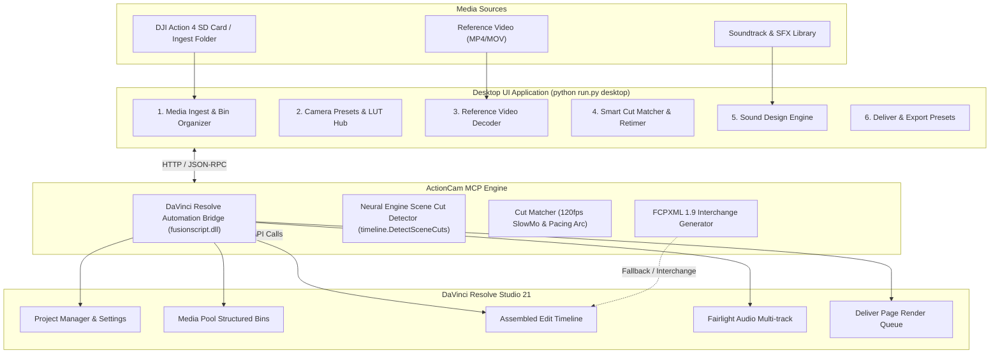

# ActionCam MCP Studio — Complete Workflow & Architecture Guide

This guide details the complete architecture, concepts, and step-by-step usage of the **ActionCam MCP Studio** desktop workflow for DJI Osmo Action 4 and DaVinci Resolve Studio 21.

---

## 1. High-Level Architecture

The system connects three key components:
1. **Desktop UI Dashboard**: A sleek, dark-mode NLE desktop application built with modern web standards, running locally in an application window.
2. **ActionCam MCP Core Engine**: A Python-based automation engine that connects directly to DaVinci Resolve Studio via `fusionscript.dll` and standard MCP JSON-RPC protocol.
3. **DaVinci Resolve Studio 21**: The production environment where Media Pool bins, decoded timelines, color grades, and render queue jobs live.

---

## 2. Step-by-Step Production Workflow

### Step 1: Media Ingest & Folder Organization
- **Selecting Source**: Specify your camera card folder (e.g. `D:/DCIM/100MEDIA`) or a local directory where you copied your raw footage.
- **Smart Detection**: The built-in ISO BMFF metadata parser reads clip timescale and frame rates. Clips shot at 60fps, 100fps, or 120fps are flagged as **SlowMo action clips**, while 24/25/30fps clips are categorized as **Realtime**.
- **Organization**: Clicking **Auto-Organize Project Files & Bins** creates the standard project hierarchy on disk and simultaneously provisions matching bins in DaVinci Resolve's Media Pool:
  - `01 Raw Footage/Realtime`
  - `01 Raw Footage/Slow Motion`
  - `02 Reference Edits`
  - `03 Audio & SFX`
  - `04 Timelines`
  - `05 Exports`

### Step 2: Camera Presets & LUTs Hub
- **DJI Action 4 10-Bit D-Log M**: Flattens high-contrast action highlights and shadows to preserve dynamic range.
- **LUT Selection**: Choose the official `DJI_Action4_DLogM_to_Rec709.cube` or creative looks (e.g. *Cinematic Action Teal & Orange*, *Mountain Vivid*).
- **Timeline Presets**: Set resolution to **1080p HD** (recommended for NVIDIA GTX 1650 4GB GPU), **4K UHD**, or **9:16 Vertical** for social feeds.
- **VFX Controls**:
  - *Auto-Retime 120fps Clips*: Automatically applies a `0.208x` speed retiming ratio for silky 25fps slow-motion playback.
  - *Optical Flow*: Directs Resolve's retime process to use Optical Flow interpolation.
  - *Dynamic Zooms*: Adds subtle slow push-in zoom keyframes on hero and establishing shots.

### Step 3: Reference Video Decoder (Reverse-Engineering Edits)
- When you provide an inspirational reference video, the workflow decodes its editing structure:
  - If DaVinci Resolve is active: Imports the reference video and runs DaVinci's Neural Engine `timeline.DetectSceneCuts()` directly on the timeline, querying every cut point, frame duration, and pacing shift.
  - If offline: Analyzes timecode, durations, and rhythm structure algorithmically.
- Generates an interactive **Timeline Cut Ribbon** and shot table classifying shots into:
  - `fast_action`: Short cuts (<0.9s), recommended for 120fps slow-mo hits.
  - `dynamic_movement`: Medium cuts (1.0s - 2.5s) for pans and subject movement.
  - `establishing_wide`: Long cuts (>2.5s) for environment/intro shots.

### Step 4: Smart Cut Assembly
- **Pacing Matching**: The Cut Matcher pairs candidate raw clips with reference shots according to shot energy:
  - High-energy cuts are automatically assigned 120fps slow-motion action shots.
  - Wide landscape shots are paired with establishing camera takes.
- **Trimming**: Skips the first 1-2 seconds of each clip to avoid camera mount vibration or operator hand shake.
- **Assembly**: Clicking **Assemble in DaVinci Resolve** sends precise frame coordinates (`startFrame`, `endFrame`, `recordFrame`) to DaVinci Resolve's `mediaPool.AppendToTimeline()`, constructing the timeline ready for playback.
- **FCPXML Interchange**: A standard `fcpxml` 1.9 file is also exported so you can share or re-import the project at any time.

### Step 5: Sound Design & Fairlight Layout
- **Audio Track A1**: Master Background Music (BGM).
- **Audio Track A2**: Cut Impacts & Beat Drops. The engine automatically places impact sound effects on high-energy transition frames.
- **Audio Track A3**: Transition Whooshes. Whoosh sounds are placed 6 frames before scene transitions to build momentum.
- **Fairlight Ducking**: Sets up audio leveling parameters so music naturally ducks during dialogue or ambient sound focus.

### Step 6: Deliver & Export Presets
- Configures DaVinci Resolve's Deliver page with optimized render settings:
  - **YouTube 4K UHD**: 3840&times;2160, H.265, 45 Mbps bitrate.
  - **Reels / Shorts (9:16)**: 1080&times;1920 vertical, H.264, 20 Mbps bitrate.
  - **Master Archive**: Lossless DNxHR HQX 10-bit master.
  - **Web 1080p Fast**: 1920&times;1080, H.264, 10 Mbps bitrate.
- Click **Add to Resolve Render Queue** or **Start Export Now** to trigger the render queue.

---

## 3. Using with Model Context Protocol (MCP)

AI agents in Claude Desktop, Antigravity, or Cursor can directly execute editing commands using the registered MCP tools.

### Example Agent Interactions:
- *"Antigravity, check if DaVinci Resolve is open."* &rarr; calls `actioncam_check_status`.
- *"Organize the SD card at D:/DCIM into F:/Edits/Project_TrailRun."* &rarr; calls `actioncam_scan_and_organize`.
- *"Analyze reference_reel.mp4 and tell me its average shot duration."* &rarr; calls `actioncam_decode_reference_video`.
- *"Assemble a 30-second edit using clips from F:/Edits/Raw matched to reference_sports.mp4, apply the D-Log M LUT, and export for Instagram Reels."* &rarr; calls `actioncam_assemble_timeline` and `actioncam_queue_export`.

---

## 4. Hardware Optimization Notes for GTX 1650 4GB

- Edit with timeline resolution set to **1080p HD (1920 &times; 1080)** during cut assembly.
- In DaVinci Resolve: **Playback > Timeline Proxy Resolution > Half** gives smooth playback even with multiple 4K 10-bit files.
- Export can switch to **4K UHD** at deliver time without re-cutting!

