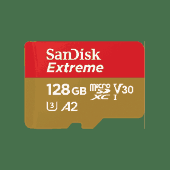

# 1. Memory Card and Recording Workflow

## Your card

You have a **SanDisk Extreme 128 GB microSD card marked V30**.



*SanDisk product image for the 128 GB Extreme microSD model. Source: [SanDisk official product page](https://www.sandisk.com/en-in/products/memory-cards/microsd-cards/sandisk-extreme-uhs-i-microsd?sku=SDSQXA1-128G-GN6MA).*

DJI says the Osmo Action 4 requires a UHS-I Speed Class 3 (U3) card and lists supported microSD capacity up to 512 GB. DJI's current recommended-card list names a SanDisk Extreme PRO 32 GB model, plus selected Kingston and Lexar models. It does **not** explicitly name your exact SanDisk Extreme 128 GB SKU.

### What that means

- **V30** indicates a minimum sustained sequential write speed of 30 MB/s under the Video Speed Class standard.
- **U3** is a separate speed-class marking commonly found on V30 cards. Check the card itself for the U3 symbol as well.
- V30 is a sensible speed class for this beginner workflow, but speed markings alone do not validate a particular card's authenticity, condition, or compatibility.
- Your exact model is therefore **speed-class suitable in principle, but not confirmed as a DJI-listed model**.

Official source: [DJI Osmo Action 4 specifications](https://www.dji.com/osmo-action-4/specs).

## Before the first recording

1. Copy any existing files from the card to your computer.
2. Confirm the card is genuine and check its printed model number and U3/V30 markings.
3. Insert the card with the camera powered off.
4. Power on and check that the camera recognizes the card and reports available capacity.
5. If the card is new or you are ready to erase it, format it **in the camera**. Formatting erases its contents.
6. Record a 10-minute continuous test at your intended settings.
7. Stop recording, play the clip on the camera, and check that there are no recording errors.
8. Copy the clip to your computer and play the copied file from beginning to end.

If the camera reports a card error, recording stops unexpectedly, or the copied clip is damaged, stop relying on the card until it has been tested or replaced.

## Optional full-capacity card test

On Windows, H2testw can test the card's actual writable capacity. This is optional and can take a long time.

**Warning:** a full write/read test overwrites data. Back up the card first and do not run it on a card containing footage you need.

## Repeatable recording routine

### Before a shoot

- Charge the battery and check free card space.
- Clean the lens cover with a suitable clean microfibre cloth.
- Confirm resolution, frame rate, colour mode, and stabilization.
- Make a 5–10 second test clip and check exposure and sound.
- Check that the card is seated and the camera shows that it is recording.

### During a shoot

- Prefer multiple short, intentional clips over one very long recording.
- Stop recording before changing major settings.
- Leave a few seconds before and after the action you want to capture.
- Avoid filling the card completely; leave working headroom.

### After a shoot

1. Stop recording and power off before removing the card.
2. Copy the complete card contents to your project folder.
3. Verify the copied clips by opening and playing them.
4. Make a second backup before formatting or reusing the card.
5. Keep the original files unchanged.

## Suggested Windows folder layout

```text
D:\IlluMen_Video_Lab\2026-11-19_Learning_01\
├── 01_Original_Camera_Files\
├── 02_Audio\
├── 03_DaVinci_Project\
├── 04_Proxy\
├── 05_Thumbnails\
└── 06_Exports\
```

Change the date and project name for each shoot. Keep LUTs in a separate library folder rather than mixing them with camera originals.

## Capacity planning

Actual recording time depends on resolution, frame rate, codec, bitrate, and scene content. Do not rely on a single fixed minutes-per-card estimate. Use the camera's remaining-time estimate as a guide and confirm with your own test recordings.

## Official references

- [DJI Osmo Action 4 specifications and recommended cards](https://www.dji.com/osmo-action-4/specs)
- [DJI basic operations and material storage](https://support.dji.com/help/content?customId=01700008145&lang=en&paperDocType=ARTICLE&re=GB&spaceId=17)
