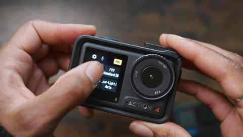
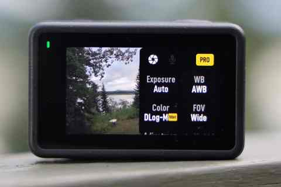

# 2. Beginner Camera Configuration

This is a deliberately simple starting profile for mixed indoor/outdoor handheld filming. It prioritizes predictable results and an easy editing workflow.

## Starter profile

| Setting | Starting value | Why |
|---|---|---|
| Mode | Video / Standard video | Everyday recording |
| Aspect ratio | 16:9 | Standard 1080p YouTube timeline |
| Resolution | 1080p | Lower editing load on GTX 1650 |
| Frame rate | 25 fps | Natural motion and practical under 50 Hz lighting |
| Colour | Normal | Ready to edit without log conversion |
| Exposure | Auto | Simplifies initial learning |
| EV | 0 | Neutral starting compensation |
| White balance | Auto | Convenient while moving locations |
| Stabilization | RockSteady 3.0 | General handheld starting point |
| Audio | Built-in microphones | Current available audio setup |

## Camera screen references

*Reference image only; confirm current on-camera labels and selected mode.*

*Reference image only; beginner recommendation remains Auto exposure, Auto WB and Normal colour.*

Some controls are mode-dependent. Do not assume every setting is available in every resolution/frame-rate combination.

## India and 50 Hz lighting

Mains-powered lights in India commonly operate at 50 Hz. Start at 25 fps to reduce flicker risk under many indoor lights. Once familiar with exposure, test 1/50 second shutter at 25 fps. This follows the 180-degree-shutter guideline but is not a universal anti-flicker guarantee: LED drivers and dimmers vary.

DJI says Action-series anti-flicker support is automatic and recommends 25/50/100 fps in 50 Hz regions. Record a short test under the exact lights and review it on a larger display.

## Exposure basics

- **Shutter speed:** how long each frame is exposed. Faster shutter reduces motion blur; slower shutter adds blur.
- **ISO:** sensor signal amplification. Higher ISO can brighten an image but usually adds visible noise.
- **EV compensation:** asks Auto exposure to make the image brighter or darker.
- **White balance:** controls colour temperature so neutral objects do not look too blue or orange.

Keep Auto exposure, EV 0 and Auto WB for the first practice session. Then continue with the dedicated [Phase 1.2 Exposure lesson](phase-1-2-exposure.md), including manual shutter, ISO, EV, WB, clipping and review scopes.

## Colour profile: Normal versus D-Log M

Normal is the beginner-friendly capture profile. D-Log M is a flatter 10-bit profile designed for post-production and needs a matching conversion. Never apply a D-Log M conversion LUT to Normal footage. See [Phase 1.4 — Colour profiles, CST and Rec.709](phase-1-4-colour-profiles-cst-rec709.md).

## Stabilization choices

DJI lists RockSteady 3.0, RockSteady 3.0+, HorizonBalancing and HorizonSteady for Action 4. Availability depends on recording mode, resolution and frame rate.

- **RockSteady 3.0:** general starting point for handheld movement.
- **RockSteady 3.0+:** stronger stabilization; compare crop/detail with standard RockSteady.
- **HorizonBalancing:** helps keep the horizon level within its supported range.
- **HorizonSteady:** locks the horizon through a wider rotation range but is more restrictive and can crop more.

DJI lists HorizonSteady for 1080p/2.7K 16:9 at up to 60 fps and HorizonBalancing for 1080p, 2.7K or 4K 16:9 at up to 60 fps. Check current on-camera availability. For the first exercise, use RockSteady 3.0.

## Field of view

Start with the least distorted, natural-looking option offered by your selected mode. Very wide views help action/POV but stretch objects near the edges. Avoid changing FOV between shots without a reason.

## Save and verify

If the current firmware offers custom presets, save the everyday profile after testing. Menu names and preset-save paths can change; follow the current DJI on-camera labels.

Before every shoot, record a short test and confirm resolution/frame rate, exposure, horizon, usable audio and successful card recording.

## Continue learning

- [Phase 1.2 — Exposure](phase-1-2-exposure.md)
- [Phase 1.3 — Frame rates and slow motion](phase-1-3-frame-rates-slow-motion.md)
- [Phase 1.4 — Colour profiles, CST and Rec.709](phase-1-4-colour-profiles-cst-rec709.md)
- [Phase 1.5 — Media workflow and Resolve performance](phase-1-5-media-workflow-performance.md)

## Official references

- [DJI Action 4 specifications](https://www.dji.com/osmo-action-4/specs)
- [DJI Support — anti-flicker guidance](https://repair.dji.com/help/content?customId=01700008288&lang=en&paperDocType=ARTICLE&re=US&spaceId=17)
