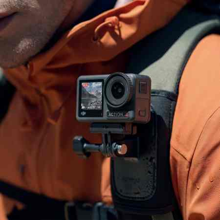
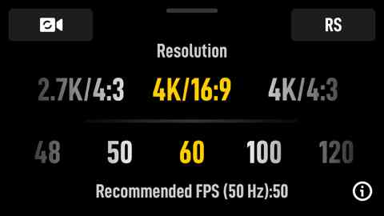
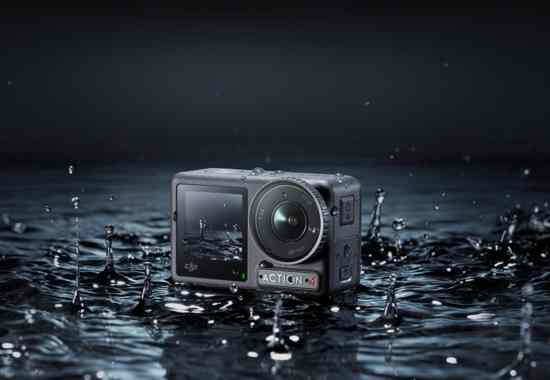
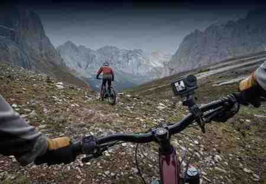

# 2. Beginner Camera Configuration

This is a deliberately simple starting profile for mixed indoor/outdoor handheld filming. It prioritizes predictable results and an easy editing workflow.

*Official DJI product photograph; this is a product reference, not a screenshot of the camera's settings menu.*

## Starter profile

| Setting | Starting value | Why |
|---|---|---|
| Mode | Video / Standard video | Normal everyday recording |
| Aspect ratio | 16:9 | Matches a standard 1080p YouTube timeline |
| Resolution | 1080p | Lower editing load on your GTX 1650 |
| Frame rate | 25 fps | Natural motion and a practical choice under 50 Hz lighting |
| Colour | Normal | Ready-to-edit image without a log conversion step |
| Exposure | Auto | Simplifies learning composition first |
| EV | 0 | Neutral starting exposure compensation |
| White balance | Auto | Convenient while moving between locations |
| Stabilization | RockSteady 3.0 | Useful starting point for handheld footage |
| Audio | Built-in microphones | Your current available audio setup |

### Camera screen references

*Resolution/frame-rate screen reference. Use the current on-camera labels and confirm that 1080p/25 fps is selected; menu layout can differ by firmware.*

*PRO-mode screen reference. The beginner recommendation remains Auto exposure, Auto white balance, and Normal colour.*

Some controls are mode-dependent. Use the closest matching option displayed by your current firmware; do not assume every setting is available in every resolution or frame-rate combination.

## India and 50 Hz lighting

Mains-powered lights in India commonly operate at 50 Hz. Starting at **25 fps** is a practical way to reduce flicker risk under many indoor lights.

For the beginner profile, leave shutter on Auto. Later, after you understand exposure, test manual shutter at approximately **1/50 second** for 25 fps footage. This follows the 180-degree-shutter guideline and often gives natural motion blur. It is not a universal anti-flicker guarantee: LED drivers and dimmers can behave differently, so always test the actual lighting.

If you see flicker:
1. Record a short test under the exact lights.
2. Try a different shutter speed or frame rate supported by the camera.
3. Review the recorded file on a larger display.
4. Prefer changing the lighting or shooting angle when practical.

## Exposure basics

Exposure is how bright or dark the recorded image appears.

*Exposure and white-balance screen reference. For your first exercise, keep exposure Auto and WB Auto; treat this as a visual aid, not a guarantee of the exact current firmware menu.*

- **Shutter speed:** how long each frame is exposed. Faster shutter freezes motion but can look staccato; slower shutter adds motion blur.
- **ISO:** how strongly the camera amplifies the sensor signal. Higher ISO can brighten an image but usually adds visible noise.
- **EV compensation:** tells automatic exposure to make the image brighter or darker than its neutral calculation.
- **White balance (WB):** controls the colour temperature so whites do not look too blue or too orange.

Keep Auto exposure, EV 0, and Auto WB for your first practice session. Change one variable at a time when you begin experimenting.

## Colour profile: Normal versus D-Log M

Normal is the beginner-friendly capture profile. D-Log M is flatter and needs a deliberate colour-managed conversion. Never apply a D-Log M conversion LUT to Normal footage.

## Stabilization choices

DJI lists RockSteady 3.0, RockSteady 3.0+, HorizonBalancing, and HorizonSteady for the Action 4. Availability depends on recording mode, resolution, and frame rate.

- **RockSteady 3.0:** a good general starting point for handheld movement.
- **RockSteady 3.0+:** stronger stabilization processing; compare the crop and detail against standard RockSteady.
- **HorizonBalancing:** helps keep the horizon level within its supported range.
- **HorizonSteady:** locks the horizon through a wider range of rotation, but is more restrictive in mode/resolution availability and can crop the image more.

For the first exercise, use RockSteady 3.0. Do not enable the strongest horizon mode for every shot: stabilization uses image cropping and may remove useful edge detail.

DJI's current specifications say HorizonSteady is available only at 1080p (16:9) or 2.7K (16:9) at 60 fps or below. HorizonBalancing is listed for 1080p, 2.7K, or 4K (16:9) at 60 fps or below. Check the current on-camera availability.

## Field of view

Start with the least distorted, natural-looking field-of-view option that your selected mode offers. Very wide views are useful for action and POV but can stretch objects near the edges. Avoid changing FOV between clips in the same simple sequence unless you have a reason.

## Colour mode: Normal first

Normal colour is the right learning choice now. It is easier to view and edit without a technical log conversion.

**Do not apply a DJI D-Log M-to-Rec.709 conversion LUT to Normal footage.** D-Log M is a different capture profile and needs its own colour-managed conversion workflow. We will introduce it only after you understand exposure, white balance, scopes, and colour spaces.

## Save and verify

If your camera firmware offers custom presets, you can save the everyday profile after testing it. Menu names and preset-save paths can change; follow the current DJI on-camera labels rather than relying on an assumed menu path.

Before every shoot, record a short test and confirm:
- The frame rate and resolution are correct.
- The image is not unintentionally overexposed.
- The horizon is reasonably level.
- The microphone captures usable sound.
- The card records without errors.

## Official reference

[DJI Osmo Action 4 specifications — recording modes and stabilization availability](https://www.dji.com/osmo-action-4/specs)
