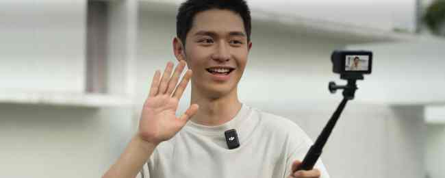
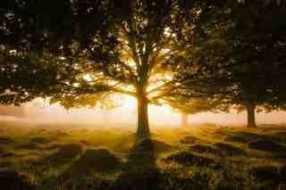
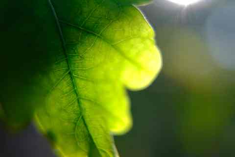
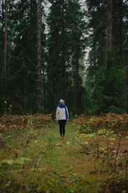
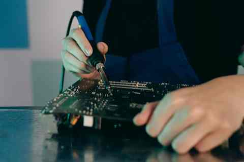
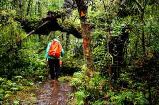

# 3. Handheld Videography and Your First Exercise

A good short video is not just a collection of long recordings. It is a sequence of shots that show the viewer where they are, what matters, and what happens.

*Official DJI Action 4 lifestyle photograph. Use it as camera-use inspiration; the six-shot examples below are separate photographic references for the shot types.*

## Handheld technique

1. Hold the camera with both hands when possible.
2. Keep elbows close to your body.
3. Stand with feet about shoulder-width apart.
4. Move slowly and deliberately.
5. Start recording before the action and hold the framing briefly after it ends.
6. Avoid fast wrist turns and sudden pans.
7. For a walking shot, bend your knees slightly and take short, soft steps.
8. Keep the lens clean and check the horizon before recording.

Stabilization helps, but it cannot make every movement smooth. Good body technique still matters.

## Built-in microphone audio

Keep the camera close enough for speech, protect the microphones from wind, and listen to a test recording with headphones.

## The six-shot mini-story

Choose a safe, accessible subject: a desk setup, a garden plant, a street scene from a safe location, a DIY task, or a small travel location.

Record each shot for roughly 8–12 seconds. These are practice lengths, not mandatory editing durations.

<figure>
  
  <figcaption>Shot 1 — Establishing: a wide garden/location view that tells the viewer where the scene takes place. Photo reference: <a href="https://images.unsplash.com/photo-1586513677534-b926f5477204">Unsplash image</a>.</figcaption>
</figure>

<figure>
  
  <figcaption>Shot 2 — Detail: a close-up leaf and texture reference. Keep the Action 4 subject at a workable focus distance. Photo reference: <a href="https://images.unsplash.com/photo-1762610744861-493bc400e80f">Unsplash image</a>.</figcaption>
</figure>

<figure>
  
  <figcaption>Shot 3 — Movement: a walking/moving-camera reference. Practise slow steps and controlled movement. Photo reference: <a href="https://images.unsplash.com/photo-1763713425806-3a4f97842abe">Unsplash image</a>.</figcaption>
</figure>

<figure>
  
  <figcaption>Shot 4 — Activity: hands working on an electronics or DIY task. Keep the activity clear in frame. Photo reference: <a href="https://www.pexels.com/photo/person-working-on-electronics-9241777/">Pexels image</a>.</figcaption>
</figure>

<figure>
  
  <figcaption>Shot 5 — POV: an outdoor trail perspective. Frame the scene from your natural eye/chest position. Photo reference: <a href="https://images.unsplash.com/photo-1676256808494-cfac58b7229a">Unsplash image</a>.</figcaption>
</figure>

<figure>
  
  <figcaption>Shot 6 — Closing: a calm golden-hour landscape that gives the mini-story a visual ending. Photo reference: <a href="https://images.unsplash.com/photo-1640619276893-f22a4b85e95c">Unsplash image</a>.</figcaption>
</figure>

| Shot | What to record | Purpose |
|---|---|---|
| 1. Establishing | A wide view of the location | Shows where we are |
| 2. Detail | A close view of an interesting object | Gives visual information |
| 3. Movement | A slow pan or controlled move | Adds visual energy |
| 4. Action | A person or object doing something | Shows what is happening |
| 5. Point of view | A view from your natural eye/chest position | Places the viewer in the scene |
| 6. Closing | A final wide or meaningful detail | Gives the sequence an ending |

### Shot-by-shot practice guidance

#### Shot 1 — Establishing

Start with a wide, stable view that tells the viewer where the scene is. Keep the horizon level and hold the camera still.

#### Shot 2 — Detail

Move close enough to reveal a useful detail or texture. The Action 4 has a minimum focus distance; do not move closer than the lens can focus.

#### Shot 3 — Controlled movement

Make one deliberate pan or camera move. Start and finish with a short static hold.

#### Shot 4 — Action

Show a person or object doing something. Keep the action clear in the frame.

#### Shot 5 — Point of view

Frame the scene from a natural eye-level or chest-level perspective.

#### Shot 6 — Closing

Finish on a calm image that gives the mini-story a visual ending.

## Practice plan

### Round A — Static framing

Record the establishing, detail, action, and closing shots without walking. Concentrate on holding a steady frame.

### Round B — Controlled movement

Record one slow pan and one short walking/POV shot. Move slower than you think is necessary.

### Round C — Audio awareness

Record 10 seconds of natural ambience. Listen for wind, traffic, fans, voices, and handling noise. Do not speak over the ambience during this test.

## Common beginner mistakes

- Recording every shot for too long.
- Panning quickly to show everything.
- Cutting off the subject's movement by stopping too early.
- Pointing the camera into bright windows and losing detail elsewhere.
- Ignoring wind noise.
- Changing resolution or colour mode between clips unintentionally.
- Moving the camera when a static shot would communicate the scene better.

## Review checklist

Watch the clips on a computer and score each from 1–5:
- Is the subject easy to understand?
- Is the framing intentional?
- Is the camera movement controlled?
- Is the exposure acceptable?
- Is the horizon level where it should be?
- Is the audio clear enough?
- Does the shot add something to the story?

Choose the weakest two clips and record them again. This review loop is more useful than immediately buying accessories.

## Your first assignment

Create a 30–60 second mini-film from the six-shot sequence. Do not add complicated transitions or effects. Use straight cuts and natural sound. The goal is to learn shot variety and continuity.

## Image source

[DJI Store — Osmo Action 4 product and lifestyle photographs](https://store.dji.com/product/osmo-action-4)
