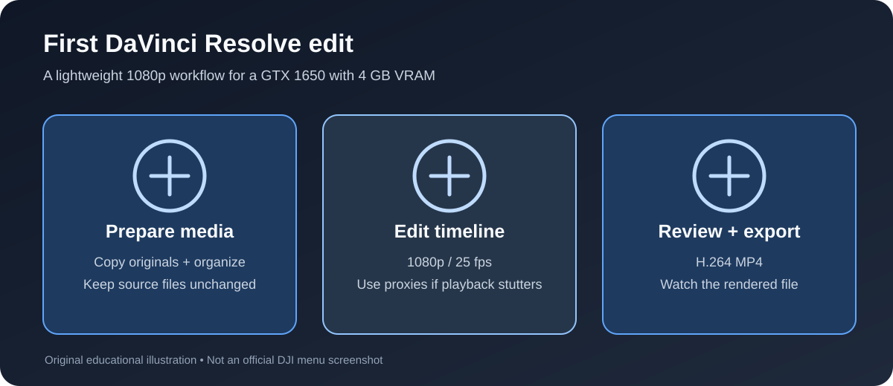

# 4. Importing Footage into DaVinci Resolve

This first editing session is designed for DaVinci Resolve Studio 21.2 on Windows 11 with 16 GB RAM and a GTX 1650 4 GB GPU.



## 1. Prepare the project folder

Copy your original camera files into a project folder before editing. Keep the camera originals unchanged.

Suggested layout:

```text
2026-11-19_Learning_01/
├── 01_Original_Camera_Files/
├── 02_Audio/
├── 03_DaVinci_Project/
├── 04_Proxy/
├── 05_Thumbnails/
└── 06_Exports/
```

## 2. Create a project

1. Open DaVinci Resolve.
2. Create a project named `Action4_Learning_01`.
3. Open Project Settings using the gear icon.
4. Set the timeline resolution to **1920 × 1080 HD**.
5. Set the timeline frame rate to **25 fps** before importing media into an empty Media Pool.
6. Save the project settings.

Resolve may lock the timeline frame rate after media has been added to the Media Pool. Choose it first.

## 3. Import and organize

1. Open the Media page.
2. Navigate to `01_Original_Camera_Files`.
3. Import the clips into the Media Pool.
4. Create bins such as `01_Establishing`, `02_Detail`, `03_Movement`, `04_Action`, `05_POV`, and `06_Closing`.
5. Preview each clip and mark the useful sections.
6. Build a timeline in the six-shot order.

## 4. Keep playback responsive

Your GTX 1650 has 4 GB VRAM and the system has 16 GB RAM. Start with a light 1080p timeline.

If playback stutters:
- Use **Playback → Timeline Proxy Resolution → Half Resolution** or **Quarter Resolution** while editing.
- Consider generating proxy media if the original codec is difficult to decode.
- Close unnecessary applications.
- Avoid heavy noise reduction, multiple Fusion effects, and complex temporal effects during this first exercise.
- Use render cache only when a specific effect or section needs it.

Timeline Proxy Resolution and generated Proxy Media are separate Resolve features. One reduces working preview resolution; the other creates alternate media files for editing.

## 5. Basic edit

1. Place the six selected clips on the timeline.
2. Trim the start and end of each clip to remove camera handling.
3. Use straight cuts.
4. Keep the sequence between 30 and 60 seconds.
5. Adjust clip volume only if needed.
6. Do not add a creative LUT or heavy colour effects yet.
7. Watch the complete sequence and fix distracting cuts.

## 6. Export a first review copy

On the Deliver page, use a simple H.264 MP4 export at 1920 × 1080 and 25 fps. A starting video bitrate around 10–15 Mb/s is reasonable for a basic 1080p review export; check the rendered file for detail, motion, and audio quality.

Export to `06_Exports` and name it `Action4_Learning_01_v1.mp4`.

## 7. Quality check

Watch the exported file from beginning to end outside Resolve. Check:
- No black frames or missing clips.
- No accidental vertical/horizontal reframing.
- No distracting exposure changes.
- No audio clipping or unexpectedly silent sections.
- Correct 1080p/25 fps output.
- The video starts and ends intentionally.

## Official reference

[Blackmagic Design DaVinci Resolve 21.1 Reference Manual](https://documents.blackmagicdesign.com/UserManuals/DaVinci_Resolve_21.1_Reference_Manual.pdf)

The manual describes project frame-rate setup, Media Pool import, proxy workflows, and project settings. Exact labels can vary slightly by Resolve release.
