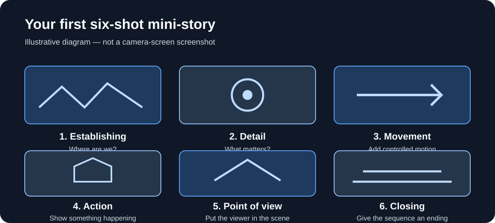

# DJI Osmo Action 4 — Beginner Getting Started

Welcome to the IlluMen_Dev Video Production Lab. This guide takes you from preparing your microSD card to recording a short sequence and importing it into DaVinci Resolve.

## Your starting setup

| Item | Current setup |
|---|---|
| Camera | DJI Osmo Action 4 |
| Firmware | Updated |
| microSD | SanDisk Extreme, 128 GB, V30 |
| Mounting | Handheld |
| Audio | Built-in camera microphones |
| Recording target | 1080p, 25 fps |
| Colour | Normal |
| Editing | DaVinci Resolve Studio 21.2 |
| Computer | Windows 11, 16 GB RAM, GTX 1650 4 GB |
| Lighting environment | India, 50 Hz mains |

## Learning path

1. [Memory card and recording workflow](01-memory-card-and-recording.md)
2. [Beginner camera configuration](02-camera-configuration.md)
3. [Handheld shooting and first exercise](03-handheld-shooting-exercise.md)
4. [Importing and editing in DaVinci Resolve](04-davinci-resolve-first-project.md)
5. [Troubleshooting and next steps](05-troubleshooting-and-next-steps.md)

## The first-video workflow

`Prepare → Configure → Record short clips → Review → Copy and verify → Edit → Export → Review`

## Important beginner rules

- Start with 1080p/25 fps and Normal colour. Learn exposure and composition before moving to D-Log M.
- Do not apply a D-Log M conversion LUT to footage recorded in Normal colour.
- Keep original camera files unchanged. Edit from a working copy when practical.
- Never format the card until your footage has been copied and verified in at least one safe location.
- Treat the exact SanDisk model as not yet DJI-validated unless its model number appears on DJI's current recommended list. A successful recording test is still essential.

## Official references

- [DJI Osmo Action 4 specifications and recommended microSD cards](https://www.dji.com/osmo-action-4/specs)
- [DJI beginner's guide: basic operations and storage](https://support.dji.com/help/content?customId=01700008145&lang=en&paperDocType=ARTICLE&re=GB&spaceId=17)
- [Blackmagic Design DaVinci Resolve 21.1 Reference Manual](https://documents.blackmagicdesign.com/UserManuals/DaVinci_Resolve_21.1_Reference_Manual.pdf)

> Menu wording and available options can vary with firmware and selected recording mode. If a label in this guide does not match your camera, use the current DJI manual and do not guess at a setting.
