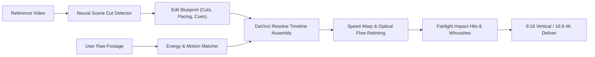

# Viral Video Cloner — Workflow Playbook

The **Viral Video Cloner** skill decodes the rhythm, motion dynamics, cut frequencies, and sound design of high-performing reference videos (TikToks, Reels, YouTube shorts, TV commercials) and recreates the edit using your chosen source footage.

---

## 1. Flow Overview



---

## 2. Step-by-Step Implementation in DaVinci Resolve

### Step 1: Decode Reference Edit
1. Import reference video to Media Pool bin `02 Reference Edits`.
2. Create timeline `Ref_Decoded`.
3. Call `timeline.DetectSceneCuts()` via DaVinci Resolve Studio Neural Engine.
4. Extract list of shots:
   - `startFrame`, `endFrame`, `durationFrames`
   - Calculate shot duration in seconds (`duration / timelineFps`).
   - Classify into:
     - **Hook (0 - 3s)**: High retention impact cut.
     - **Fast Montage (<0.9s)**: Fast rhythm, candidate for slow-motion speed ramps.
     - **Medium Action (1.0s - 2.5s)**: Dynamic camera movement.
     - **Hero / Establishing (>2.5s)**: Wider scenery.

### Step 2: Match Raw Clips to Cut Energy
1. Scan source folders.
2. Group clips:
   - `120fps / 60fps`: Action, jumps, velocity peaks.
   - `25fps / 30fps`: Establishing, walking, scenery.
3. For fast montage shots, select 120fps clips and retime to `0.208x` speed ratio so high frame rate footage plays in smooth slow-motion.
4. Apply DaVinci Neural Engine **Speed Warp** motion estimation:
   ```python
   clip.SetProperty("Retime Process", "Optical Flow")
   clip.SetProperty("Motion Estimation", "Speed Warp")
   ```

### Step 3: Color Transformation & LUT Matching
1. For DJI Action 4 D-Log M footage, apply `DJI_Action4_DLogM_to_Rec709.cube` to Node 1.
2. For stylized recreation (e.g. Teal & Orange contrast or Vibrant Action), apply creative grade in Node 2.

### Step 4: Sound Design Cues
1. Audio Track 1: Master soundtrack aligned to visual cuts.
2. Audio Track 2: Sub-bass impact hits placed on beat drops and scene transitions.
3. Audio Track 3: Transition whooshes positioned 4 to 6 frames before scene changes.

